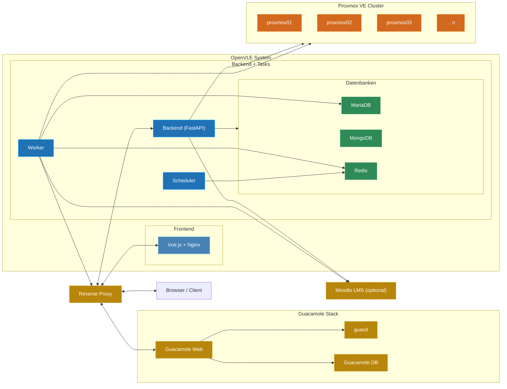

# Infrastruktur {#infrastructure}

OpenVLE besteht aus mehreren Docker-Containern, die gemeinsam als Docker-Compose-Stack betrieben werden. Zusätzlich werden externe Systeme (Proxmox VE, optional Apache Guacamole und Moodle) angebunden. Dieser Bereich beschreibt die Architektur, die verwendeten Komponenten und ihre Zusammenhänge.

## Architekturdiagramm {#architecture-diagram}

**Legende:**

| Farbe              | Bedeutung                                                    |
| ------------------ | ------------------------------------------------------------ |
| Gelb (gestrichelt) | Externe Komponenten (Reverse Proxy, Guacamole Stack, Moodle) |
| Blau (hell)        | Frontend — Vue.js-Anwendung mit Nginx                        |
| Blau (dunkel)      | Backend / Tasks — FastAPI, Worker, Scheduler                 |
| Grün               | Datenbanken — MariaDB, MongoDB, Redis                        |
| Orange             | Proxmox VE Cluster — Hypervisor-Infrastruktur (extern)       |

## Komponenten auf einen Blick {#components-overview}

### OpenVLE Docker-Stack {#internal-components}

| Komponente           | Typ            | Zweck                                                                      |
| -------------------- | -------------- | -------------------------------------------------------------------------- |
| **Backend**          | Python/FastAPI | REST-API, Geschäftslogik, Proxmox-Integration                              |
| **Frontend**         | Vue.js/Nginx   | Weboberfläche                                                              |
| **Worker** (3 Typen) | RQ Worker      | Asynchrone Hintergrundaufgaben (VM-Operationen, E-Mail, Guacamole, Moodle) |
| **Scheduler**        | RQ Cron        | Periodische Aufgaben nach Zeitplan                                         |
| **MariaDB**          | Relationale DB | Kernentitäten (Benutzer, Rollen, Umgebungen, VMs, ...)                     |
| **MongoDB**          | Dokumenten-DB  | Aktivitäten, System-Events, Audit-Logs                                     |
| **Redis**            | In-Memory      | Task-Queue und Cache                                                       |

### Externe Systeme {#external-systems}

| System               | Erforderlich        | Zweck                                     |
| -------------------- | ------------------- | ----------------------------------------- |
| **Proxmox VE**       | Ja                  | Hypervisor-Cluster zur VM-Verwaltung      |
| **Reverse Proxy**    | Empfohlen           | SSL-Terminierung und Routing              |
| **Apache Guacamole** | Optional, empfohlen | Webbasierter Remote-Desktop-Zugang zu VMs |
| **Moodle**           | Optional            | Lernmanagementsystem-Anbindung            |
| **SMTP-Server**      | Ja                  | E-Mail-Versand                            |
| **LDAP-Server**      | Optional            | Benutzer-Authentifizierung                |
| **OIDC-Provider**    | Optional            | Single Sign-On                            |

:::info Externe Abhängigkeiten
**Proxmox VE**, **Apache Guacamole** und **Moodle** werden nicht im OpenVLE Docker-Compose-Stack betrieben. Sie müssen separat installiert und konfiguriert werden. Siehe [Proxmox VE Integration](../install/proxmoxve), [Apache Guacamole Integration](../install/guacamole) und [Moodle Integration](../install/moodle) für die Einrichtung.
:::

## Weiter lesen {#topics}

1. [Verwendete Komponenten](components) — Docker-Container im Detail: SERVICE_ROLE, Ports, Health Checks, Persistenz
2. [Netzwerk & Docker](networking) — Docker-Netzwerk, Ports und Kommunikationspfade
3. [Datenbanken](databases) — MariaDB, MongoDB und Redis: Aufgabenteilung und Datenhaltung
4. [Task-System](task-system) — Worker, Scheduler und die Redis-Queue für Hintergrundaufgaben
5. [Authentifizierung](authentication) — Lokale Anmeldung, LDAP und OIDC
6. [Berechtigungssystem](permission-system) — Rollen, Berechtigungen und Zugriffskontrolle
7. [Proxmox VE](proxmoxve) — VM-Verwaltung, Node-Management und Cluster-Integration **(erforderlich)**
8. [Apache Guacamole](guacamole) — Remote-Desktop-Zugang über Apache Guacamole _(optional, empfohlen)_
9. [Moodle](moodle) — Anbindung an das Lernmanagementsystem Moodle _(optional)_
