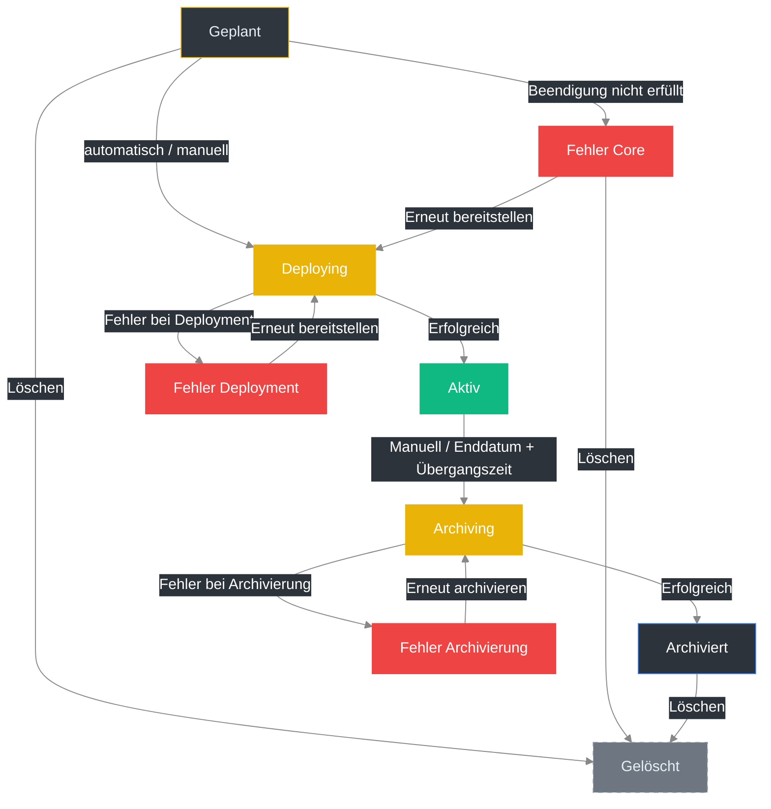

import { Example } from '@site/src/components/Example.mdx'
import { FeatureList } from '@site/src/components/FeatureList.mdx'
import { FieldReference } from '@site/src/components/FieldReference.mdx'
import { NavigationHint } from '@site/src/components/NavigationHint.mdx'
import { ObjectRelations } from '@site/src/components/ObjectRelations.mdx'
import { Permissions } from '@site/src/components/Permissions.mdx'
import { RelatedLinks } from '@site/src/components/RelatedLinks.mdx'

# Veranstaltungen

In **OpenVLE** bilden **Veranstaltungen** das organisatorische Gerüst für eine **Umgebung**.  
Sie bündeln Umgebungsinhalte, Benutzergruppen und virtuelle Maschinen und sorgen dafür, dass Lern- oder Schulungsszenarien zeitlich, personell und technisch strukturiert ablaufen.

{/* TODO: Screenshot hinzufügen – Veranstaltungsübersicht */}

---

## Wo finde ich den Bereich?

<NavigationHint
  path="Veranstaltungen"
  alternative="Über Benutzer, Umgebungen oder virtuelle Maschinen verlinkt"
/>

---

## Funktionen im Überblick

<FeatureList
  items={[
    'Erstellen, Bearbeiten und Löschen von Veranstaltungen',
    'Zuweisen von Umgebungen und Benutzergruppen',
    'Starten und Stoppen von Veranstaltungen (Deployment und Dekommissionierung)',
    'Verwalten von Laufzeiten und automatischer Beendigung',
    'Einsehen aktiver, geplanter und abgeschlossener Veranstaltungen',
  ]}
/>

{/* TODO: Screenshot hinzufügen – Veranstaltungsdetails */}

---

## Wichtige Felder im Überblick

<FieldReference
  fields={[
    {
      name: 'Name',
      description:
        'Anzeigename der Veranstaltung. Wird in Listen, Dialogen und Verbindungsnamen angezeigt. Nach dem Ausrollen ist er Teil des Verbindungstitels in Apache Guacamole.',
    },
    {
      name: 'Kurzname',
      description:
        'Kurzbezeichnung der Veranstaltung (4–8 Zeichen). Erlaubt sind Kleinbuchstaben, Zahlen, Unterstriche (_) und Bindestriche (-). Wird beim Deployment in die Namen der erstellten virtuellen Maschinen integriert.',
    },
    {
      name: 'Beschreibung',
      description:
        'Freitextfeld zur Erläuterung des Zwecks oder Inhalts der Veranstaltung. Wird in Übersichten und Detailansichten angezeigt.',
    },
    {
      name: 'Umgebung',
      description:
        'Referenz auf die zugewiesene Umgebung. Diese Umgebung definiert die zu verwendenden Vorlagen, Anwendungen und Netzwerkeinstellungen für die Veranstaltung.',
    },
    {
      name: 'Beginn (Datum)',
      description:
        'Startdatum der Veranstaltung. Ab diesem Zeitpunkt stehen die zugewiesenen Ressourcen zur Verfügung.',
    },
    {
      name: 'Ende (Datum)',
      description:
        'Enddatum der Veranstaltung. Wenn kein Enddatum gesetzt ist, läuft die Veranstaltung unbegrenzt. Nach Erreichen des Enddatums beginnt eine konfigurierbare Übergangszeit (siehe **Administration → Konfiguration**). Danach werden virtuelle Maschinen, Verbindungen und zugehörige Ressourcen automatisch gelöscht.',
    },
    {
      name: 'Beginn (Zeit)',
      deprecated: true,
      description: 'Wird nicht mehr verwendet.',
    },
    {
      name: 'Ende (Zeit)',
      deprecated: true,
      description: 'Wird nicht mehr verwendet.',
    },
  ]}
/>

---

## Verschiedene Stati einer Veranstaltung

Jede Veranstaltung in **OpenVLE** durchläuft im Lebenszyklus mehrere Statusphasen.  
Die folgende Übersicht beschreibt die möglichen Stati und deren Bedeutung:

| Status                    | Beschreibung                                                                                                                                                                                                                                                                                                                                                                                                                                                           |
| ------------------------- | ---------------------------------------------------------------------------------------------------------------------------------------------------------------------------------------------------------------------------------------------------------------------------------------------------------------------------------------------------------------------------------------------------------------------------------------------------------------------- |
| **Geplant**               | Wird beim Erstellen automatisch gesetzt. Eine Veranstaltung im Status _Geplant_ wird automatisch **X Tage vor dem Startdatum** ausgerollt, sodass sie bereits vor Beginn bereitsteht. Die Anzahl der Tage ist in den **Systemeinstellungen** ([System → Einstellungen](/docs/usage/openvle/system/settings)) konfigurierbar und wird in der Detailansicht angezeigt.   Eine manuelle Transition aus dem Status _Geplant_ ist **nicht möglich**.                |
| **Deploying**             | Die Veranstaltung wird aktuell bereitgestellt („Deployment“). Während dieses Prozesses können **keine Änderungen** vorgenommen und **keine Teilnehmenden hinzugefügt oder entfernt** werden. Der aktuelle Fortschritt kann über die der Veranstaltung zugewiesenen **Tasks** eingesehen werden.   Nach erfolgreichem Deployment wechselt der Status automatisch zu **Aktiv**. Tritt ein Fehler auf, wechselt er zu **Fehler (Deployment)**.                    |
| **Aktiv**                 | Die Veranstaltung läuft und alle zugehörigen VMs und Verbindungen stehen zur Verfügung. Änderungen (z. B. Teilnehmende hinzufügen oder entfernen) sind in diesem Status möglich. Die Veranstaltung bleibt solange aktiv, bis das Enddatum erreicht ist (falls vorhanden) oder sie manuell beendet wird.                                                                                                                                                                |
| **Fehler (Core)**         | Das Deployment konnte nicht gestartet werden, da eine **grundlegende Voraussetzung** nicht erfüllt war. Ein detaillierter Fehlerbericht wird in der Veranstaltungsansicht angezeigt.   Von diesem Status aus kann ein erneuter Bereitstellungsversuch gestartet werden – die Veranstaltung wechselt dann erneut in den Status **Deploying**. Ein Löschen ist **möglich**.                                                                                      |
| **Fehler (Deployment)**   | Das Deployment ist fehlgeschlagen. Ein detaillierter Fehlerbericht wird in der Veranstaltungsansicht angezeigt.   Von diesem Status aus kann ein erneuter Bereitstellungsversuch gestartet werden – die Veranstaltung wechselt dann erneut in den Status **Deploying**. Ein Löschen ist **nicht möglich**.                                                                                                                                                     |
| **Fehler (Archivierung)** | Das Archivieren ist fehlgeschlagen. Ein detaillierter Fehlerbericht wird in der Veranstaltungsansicht angezeigt.   Von diesem Status aus kann ein erneuter Archivierungsversuch gestartet werden – die Veranstaltung wechselt dann erneut in den Status **Archiving**. Ein Löschen ist **nicht möglich**.                                                                                                                                                      |
| **Archiving**             | Nach Ablauf des Enddatums und der in den **Systemeinstellungen** konfigurierten **Übergangszeit** oder nach einem **manuellen Beenden** wird die Veranstaltung automatisch in diesen Status versetzt.  Während des Archivierungsvorgangs werden alle zugehörigen **VMs** und **Verbindungen** gelöscht.  Nach erfolgreichem Archivieren wechselt der Status automatisch zu **Archiviert**. Tritt ein Fehler auf, wechselt er zu **Fehler (Archivierung)**. |
| **Archiviert**            | Das Archiving wurde erfolgreich abgeschlossen. Alle Ressourcen wurden entfernt. Veranstaltungen in diesem Status können **nicht mehr gestartet**, aber **gelöscht** werden.                                                                                                                                                                                                                                                                                            |
| **Inaktiv**               | Interner Zustand für deaktivierte oder manuell gestoppte Veranstaltungen. Dieser Status tritt selten auf und dient administrativen Zwecken.                                                                                                                                                                                                                                                                                                                            |
| **Stopped**               | Temporärer Zustand, wenn eine Veranstaltung manuell gestoppt wurde. Die zugehörigen **VMs** sind in diesem Fall heruntergefahren und die **Verbindungen deaktiviert**. Die Veranstaltung kann bei Bedarf erneut aktiviert werden.                                                                                                                                                                                                                                      |

**Wichtige Hinweise**

- Eine Veranstaltung kann **nur** in den Stati **Geplant** oder **Archiviert** gelöscht werden.
- Während der Stati **Deploying** oder **Archiving** sind **keine Änderungen** möglich.
- Die automatischen Übergänge (z. B. von _Geplant_ → _Deploying_ → _Aktiv_ oder _Aktiv_ → _Archiving_ → _Archiviert_) werden durch Systemprozesse gesteuert und können **nicht manuell ausgelöst** werden.
- In den Systemeinstellungen unter **System → Einstellungen** können sowohl die **Vorbereitungszeit (Pre-Deployment)** als auch die **Übergangszeit nach Ende** konfiguriert werden.

> 💡 **Tipp:**  
> Wenn wiederholt ein Fehler im Status _Deploying_ oder _Archiving_ auftritt, prüfe die zugehörigen **Tasks**.  
> Dort findest du detaillierte Fehlermeldungen und Logs für die Ursache.

---

### Statusübergänge im Überblick

---

## Erstellen einer Veranstaltung {#create-event}

1. Öffne im Hauptmenü den Bereich **Veranstaltungen**.
2. Klicke auf **Hinzufügen**, um eine neue Veranstaltung zu erstellen.
3. Vergib einen **Namen** und eine **Beschreibung**.
4. Wähle eine vorhandene **Umgebung** aus.
5. Lege das **Start-** und optional das **Enddatum** der Veranstaltung fest.
6. Speichere die Veranstaltung.  
   Die Veranstaltung wird nun im Status **„Geplant”** erstellt.
7. Füge anschließend Teilnehmende hinzu.

:::info Beziehung zwischen Veranstaltung und VM-Vorlagen
Beim Erstellen einer Veranstaltung wird die gewählte Umgebung nur als Referenz gespeichert. Die direkte Beziehung zwischen der Veranstaltung und den VM-Vorlagen wird erst beim **Ausrollen** angelegt. Wird die Umgebung zwischen dem Erstellen und dem Ausrollen geändert, verwendet die Veranstaltung beim Deployment die **aktuelle** Version der Umgebung.
:::

---

## Bearbeiten einer Veranstaltung {#edit-event}

1. Öffne im Hauptmenü den Bereich **Veranstaltungen**.
2. Suche in der Liste nach der gewünschten Veranstaltung.
3. Klicke auf **Bearbeiten**, oder öffne das Kontextmenü der Veranstaltung und wähle **Bearbeiten**.
4. Im Formular werden alle aktuellen Daten der Veranstaltung angezeigt.
5. Passe die gewünschten Felder an – beispielsweise **Name**, **Beschreibung** oder **Umgebung**.
6. Speichere die Änderungen.

:::warning
Nur Veranstaltungen im Status **„Geplant“** können bearbeitet werden.  
Änderungen an **Name**, **Beschreibung** oder der **zugewiesenen Umgebung** sind in anderen Stati nicht mehr möglich.
:::

---

## Teilnehmende per CSV importieren {#import-participants}

Über den **Teilnehmenden-Import** kannst du viele **bereits vorhandene** Benutzer in einem Schritt zu einer Veranstaltung hinzufügen, indem du eine CSV-Datei mit ihren E-Mail-Adressen hochlädst.

<NavigationHint
  path="Veranstaltungen → Detailansicht → Teilnehmende → Importieren"
  alternative="Über den Button „Importieren“ im Teilnehmenden-Bereich der Veranstaltung"
/>

:::warning Fügt bestehende Benutzer hinzu – legt keine an
Der Teilnehmenden-Import sucht Benutzer **anhand ihrer E-Mail-Adresse** (Groß- und Kleinschreibung wird ignoriert) und weist sie der Veranstaltung mit der Rolle **Teilnehmende (Students)** zu. Er **legt keine neuen Benutzer an**. Benutzer, die noch nicht existieren, müssen zuerst über den [Benutzer-Import](/docs/usage/openvle/access-control/users/#import-users) angelegt werden.
:::

Der Import nutzt denselben vierstufigen Assistenten wie der Benutzer-Import (Hochladen → Spalten zuordnen → Vorschau & Import → Ergebnis), erwartet aber **nur eine einzige Spalte**:

<FieldReference
  fields={[
    {
      name: 'email',
      description:
        'Pflichtfeld und einzige Spalte. E-Mail-Adresse eines bereits vorhandenen Benutzers. Muss ein „@“ enthalten.',
    },
  ]}
/>

### Grenzen und Ergebnis

- Pro Import werden maximal **200 Zeilen** verarbeitet; zusätzlich gilt eine maximale Dateigröße von **5 MB**.
- Nach dem Import zeigt die Ergebnisansicht je Zeile das Resultat an. Häufige Fehler:
  - **Ungültige E-Mail** – die Adresse enthält kein „@“.
  - **Benutzer nicht gefunden** – zu dieser E-Mail-Adresse existiert kein Benutzer (er muss zuerst über den Benutzer-Import angelegt werden).
  - **Unbekannter Fehler** – das Hinzufügen ist aus einem anderen Grund fehlgeschlagen.

:::note
Der Import steht nur zur Verfügung, solange Teilnehmende geändert werden dürfen (z. B. in den Stati **Geplant** oder **Aktiv**). Während der Stati **Deploying** oder **Archiving** ist er deaktiviert.
:::

Der Import erfordert das Bearbeiten der Veranstaltung (`events_update`) sowie das Anzeigen von Benutzern (`users_read`, siehe [Erforderliche Berechtigungen](#erforderliche-berechtigungen)).

---

## Ausrollen einer Veranstaltung

1. Öffne im Hauptmenü den Bereich **Veranstaltungen**.
2. Suche in der Liste nach der gewünschten Veranstaltung.
3. Klicke auf **Ausrollen**, oder öffne das Kontextmenü der Veranstaltung und wähle **Ausrollen**.
4. Im Formular werden alle aktuellen Daten der Veranstaltung angezeigt.
5. Bestätige das Ausrollen im angezeigten Dialog.
6. Die Veranstaltung wechselt in den Status **„Deploying“**; die **virtuellen Maschinen** und **Verbindungen** werden erstellt.  
   Über den Fortschritt wird die **Erstellerin bzw. der Ersteller** der Veranstaltung per **E-Mail** benachrichtigt.

:::warning
Nur Veranstaltungen im Status **„Geplant“** können ausgerollt werden.
:::

:::note
Während des Status **„Deploying“** sind **keine Änderungen** an der Veranstaltung möglich.  
Nach erfolgreichem Abschluss wechselt der Status zu **„Aktiv“**.
:::

---

## Beenden einer Veranstaltung (Archivierung)

1. Öffne im Hauptmenü den Bereich **Veranstaltungen**.
2. Suche in der Liste nach der gewünschten Veranstaltung.
3. Klicke auf **Stoppen**, oder öffne das Kontextmenü der Veranstaltung und wähle **Stoppen**.
4. Im Formular werden alle aktuellen Daten der Veranstaltung angezeigt.
5. Bestätige das Beenden im angezeigten Dialog.
6. Die Veranstaltung wechselt in den Status **„Archiving“**; die **virtuellen Maschinen** und **Verbindungen** werden gelöscht.  
   Über den Fortschritt wird die **Erstellerin bzw. der Ersteller** der Veranstaltung per **E-Mail** benachrichtigt.

:::warning
Nur Veranstaltungen im Status **„Aktiv“** können beendet werden.
:::

:::note
Während des Status **„Archiving“** sind **keine Änderungen** an der Veranstaltung möglich.  
Nach erfolgreichem Abschluss wechselt der Status zu **„Archiviert“**.
:::

---

## Bulk-Aktionen {#bulk-actions}

Bei **aktiven** Veranstaltungen stehen Bulk-Aktionen zur Verfügung, um Massenoperationen an allen VMs oder Verbindungen einer Veranstaltung gleichzeitig durchzuführen.

1. Öffne im Hauptmenü den Bereich **Veranstaltungen**.
2. Suche in der Liste nach der gewünschten Veranstaltung im Status **„Aktiv"**.
3. Öffne die Detailansicht der Veranstaltung.
4. Klicke auf den Button **Aktionen** und wähle die gewünschte Bulk-Aktion aus.
5. Bestätige die Aktion im angezeigten Dialog.
6. Die Aktion wird auf alle betroffenen VMs bzw. Verbindungen der Veranstaltung gleichzeitig angewendet.

:::warning
Nur Veranstaltungen im Status **„Aktiv"** unterstützen Bulk-Aktionen.
:::

### VM-Aktionen {#bulk-vm-actions}

Folgende Aktionen können auf **alle virtuellen Maschinen** einer Veranstaltung gleichzeitig angewendet werden:

- **Alle VMs starten** — Startet sämtliche VMs der Veranstaltung
- **Alle VMs stoppen** — Stoppt sämtliche VMs sofort (Hard Stop)
- **Alle VMs herunterfahren** — Fährt sämtliche VMs sauber über den Guest Agent herunter
- **Alle VMs neustarten** — Startet sämtliche VMs neu
- **Alle VMs zurücksetzen** — Führt einen Hard-Reset aller VMs durch

### Verbindungs-Aktionen {#bulk-connection-actions}

Folgende Aktionen können auf **alle Verbindungen** einer Veranstaltung gleichzeitig angewendet werden:

- **Alle Verbindungen erstellen** — Erstellt alle Verbindungen der Veranstaltung neu
- **Alle Verbindungen löschen** — Löscht sämtliche Verbindungen der Veranstaltung

---

## Löschen einer Veranstaltung

1. Öffne im Hauptmenü den Bereich **Veranstaltungen**.
2. Suche in der Liste nach der gewünschten Veranstaltung.
3. Klicke auf **Löschen**, oder öffne das Kontextmenü der Veranstaltung und wähle **Löschen**.
4. Bestätige den Löschvorgang im angezeigten Dialog.
5. Die Veranstaltung wird daraufhin dauerhaft entfernt.

:::warning
Nur Veranstaltungen im Status **„Geplant“** oder **„Archiviert“** können gelöscht werden.
:::

---

## Beispiel oder Anwendungsfall

<Example title="Neue Schulungsveranstaltung bereitstellen">
  Eine Administratorin möchte eine Schulung mit einer Umgebung bereitstellen.
  Sie erstellt im Bereich **Veranstaltungen** den Eintrag *„Linux Grundlagen –
  Herbstkurs“*, legt Start- und Enddatum fest und wählt die Umgebung
  **Einsteiger und Fortgeschrittene** aus. Nach dem Speichern fügt sie alle
  Teilnehmenden hinzu und startet das **Deployment**. Dadurch werden automatisch
  alle zugehörigen virtuellen Maschinen und Verbindungen erstellt und
  konfiguriert.
</Example>

{/* TODO: Screenshot hinzufügen – Beispiel: Veranstaltung mit mehreren Umgebungen */}

---

## Hinweise / Besonderheiten

- Eine Veranstaltung enthält genau **eine Umgebung**, diese kann jedoch mehrere **VM-Vorlagen** referenzieren.
- Änderungen an der zugewiesenen Umgebung (z. B. Hinzufügen oder Entfernen von VM-Vorlagen) betreffen **geplante** Veranstaltungen, da die direkte Beziehung zwischen Veranstaltung und VM-Vorlagen erst beim Ausrollen erstellt wird. **Aktive** Veranstaltungen bleiben davon unberührt.
- Beim **Deployment** werden für alle Teilnehmenden jeweils virtuelle Maschinen basierend auf den der Umgebung zugewiesenen VM-Vorlagen erstellt und konfiguriert.  
  Zusätzlich erhält jede teilnehmende Person individuelle Verbindungen auf Basis der **Verbindungsvorlagen**, die den jeweiligen VM-Vorlagen zugewiesen sind.  
  Teilnehmende mit der Rolle **Lehrende** erhalten darüber hinaus Verbindungen zu **allen** virtuellen Maschinen der Veranstaltung.
- Über die Schaltfläche **Stoppen** können alle VMs der Veranstaltung beendet **und** entfernt werden.
- Die **Erstellerin bzw. der Ersteller** einer Veranstaltung erhält automatisch für **alle erstellten virtuellen Maschinen und Verbindungen** **Vollzugriffsberechtigungen**.
- **Teilnehmende** erhalten automatisch die Berechtigung **„Lesen & VM-Steuerung“** auf **ihre eigene virtuelle Maschine**.
- Änderungen an einer laufenden Veranstaltung (z. B. das Hinzufügen oder Entfernen von Teilnehmenden) wirken sich unmittelbar aus.
- Veranstaltungen mit aktivem Deployment können nur von Benutzerinnen und Benutzern mit der Berechtigung (`events_actions_end`) beendet werden.
- Das Starten oder Stoppen einer Veranstaltung kann – abhängig von der Anzahl der VMs – einige Zeit in Anspruch nehmen.  
  Die Erstellerin oder der Ersteller erhält automatisch eine **E-Mail-Benachrichtigung**, sobald das Deployment oder das Stoppen/Archivieren abgeschlossen ist oder ein Fehler aufgetreten ist.
- Die Anzeige aktualisiert sich regelmäßig, solange der Bereich geöffnet ist.

---

## Beziehungen zu anderen Objekten

<ObjectRelations
  showTasks={true}
  items={[
    {
      object: 'Umgebungen',
      description: 'Jeder Veranstaltung ist genau eine Umgebung zugewiesen.',
      behavior: 'Keine Automatisierungen.',
    },
    {
      object: 'Teilnehmende (Benutzer)',
      description:
        'Einer Veranstaltung können beliebig viele Teilnehmende zugewiesen werden.',
      behavior: 'Keine Automatisierungen.',
    },
    {
      object: 'VM-Vorlagen',
      description:
        'Einer Veranstaltung können beliebig viele VM-Vorlagen zugeordnet werden.',
      behavior: 'Keine Automatisierungen.',
    },
    {
      object: 'E-Mails',
      description:
        'Einer Veranstaltung können beliebig viele gesendete E-Mails zugewiesen werden.',
      behavior: 'Keine Automatisierungen.',
    },
    {
      object: 'Virtuelle Maschinen (VMs)',
      description:
        'Einer Veranstaltung können beliebig viele VMs zugewiesen werden.',
      behavior:
        'Beim Beenden der Veranstaltung werden alle zugehörigen VMs automatisch gelöscht.',
    },
    {
      object: 'Verbindungen',
      description:
        'Einer Veranstaltung können beliebig viele Verbindungen zugewiesen werden.',
      behavior:
        'Beim Beenden der Veranstaltung werden alle zugehörigen Verbindungen automatisch gelöscht.',
    },
  ]}
/>

---

## Erforderliche Berechtigungen

<Permissions
  data={[
    {
      action: 'Veranstaltungen anzeigen',
      permission: 'events_read',
      scoped: true,
    },
    { action: 'Veranstaltungen anlegen', permission: 'events_create' },
    {
      action: 'Veranstaltungen bearbeiten',
      permission: 'events_update',
      scoped: true,
    },
    {
      action: 'Veranstaltungen löschen',
      permission: 'events_delete',
      scoped: true,
    },
    {
      action: 'Veranstaltungen starten',
      permission: 'events_actions_start',
      scoped: true,
    },
    {
      action: 'Veranstaltungen beenden',
      permission: 'events_actions_end',
      scoped: true,
    },
    { action: 'Benutzer anzeigen', permission: 'users_read', scoped: true },
    { action: 'Umgebungen anzeigen', permission: 'courses_read', scoped: true },
  ]}
/>

---

## Verwandte Themen

<RelatedLinks
  items={[
    { label: 'Umgebungen', href: '../courses' },
    { label: 'Virtuelle Maschinen', href: '../vms' },
    { label: 'VM-Vorlagen', href: '../vm-templates' },
    { label: 'Verbindungen', href: '../connections' },
  ]}
/>
