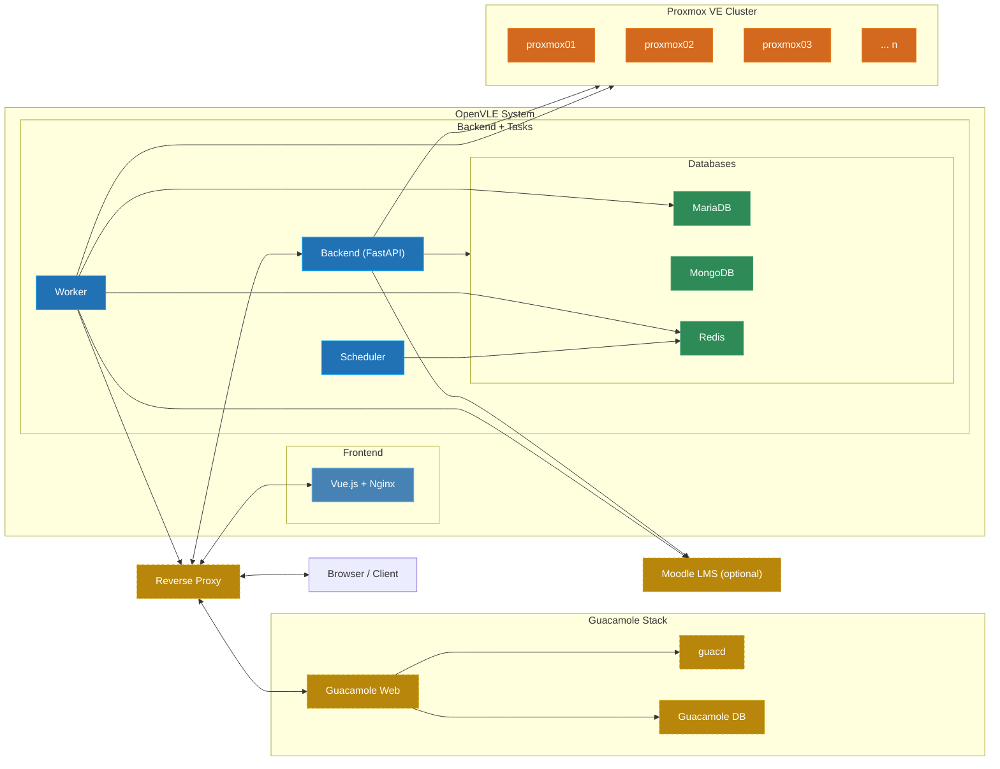

# Infrastructure {#infrastructure}

OpenVLE consists of multiple Docker containers that are operated together as a Docker Compose stack. Additionally, external systems (Proxmox VE, optionally Apache Guacamole and Moodle) are connected. This section describes the architecture, the components used, and their relationships.

## Architecture Diagram {#architecture-diagram}

**Legend:**

| Color           | Meaning                                                      |
| --------------- | ------------------------------------------------------------ |
| Yellow (dashed) | External components (Reverse Proxy, Guacamole Stack, Moodle) |
| Blue (light)    | Frontend -- Vue.js application with Nginx                    |
| Blue (dark)     | Backend / Tasks -- FastAPI, Worker, Scheduler                |
| Green           | Databases -- MariaDB, MongoDB, Redis                         |
| Orange          | Proxmox VE Cluster -- Hypervisor infrastructure (external)   |

## Components at a Glance {#components-overview}

### OpenVLE Docker Stack {#internal-components}

| Component            | Type           | Purpose                                                                 |
| -------------------- | -------------- | ----------------------------------------------------------------------- |
| **Backend**          | Python/FastAPI | REST API, business logic, Proxmox integration                           |
| **Frontend**         | Vue.js/Nginx   | Web interface                                                           |
| **Worker** (3 types) | RQ Worker      | Asynchronous background tasks (VM operations, email, Guacamole, Moodle) |
| **Scheduler**        | RQ Cron        | Periodic tasks on a schedule                                            |
| **MariaDB**          | Relational DB  | Core entities (users, roles, environments, VMs, ...)                    |
| **MongoDB**          | Document DB    | Activities, system events, audit logs                                   |
| **Redis**            | In-Memory      | Task queue and cache                                                    |

### External Systems {#external-systems}

| System               | Required              | Purpose                                |
| -------------------- | --------------------- | -------------------------------------- |
| **Proxmox VE**       | Yes                   | Hypervisor cluster for VM management   |
| **Reverse Proxy**    | Recommended           | SSL termination and routing            |
| **Apache Guacamole** | Optional, recommended | Web-based remote desktop access to VMs |
| **Moodle**           | Optional              | Learning management system integration |
| **SMTP Server**      | Yes                   | Email delivery                         |
| **LDAP Server**      | Optional              | User authentication                    |
| **OIDC Provider**    | Optional              | Single Sign-On                         |

:::info External Dependencies
**Proxmox VE**, **Apache Guacamole**, and **Moodle** are not operated within the OpenVLE Docker Compose stack. They must be installed and configured separately. See [Proxmox VE Integration](../install/proxmoxve), [Apache Guacamole Integration](../install/guacamole), and [Moodle Integration](../install/moodle) for setup instructions.
:::

## Further Reading {#topics}

1. [Used Components](components) -- Docker containers in detail: SERVICE_ROLE, ports, health checks, persistence
2. [Networking & Docker](networking) -- Docker network, ports, and communication paths
3. [Databases](databases) -- MariaDB, MongoDB, and Redis: task separation and data storage
4. [Task System](task-system) -- Worker, Scheduler, and the Redis queue for background tasks
5. [Authentication](authentication) -- Local login, LDAP, and OIDC
6. [Permission System](permission-system) -- Roles, permissions, and access control
7. [Proxmox VE](proxmoxve) -- VM management, node management, and cluster integration **(required)**
8. [Apache Guacamole](guacamole) -- Remote desktop access via Apache Guacamole _(optional, recommended)_
9. [Moodle](moodle) -- Integration with the Moodle learning management system _(optional)_
