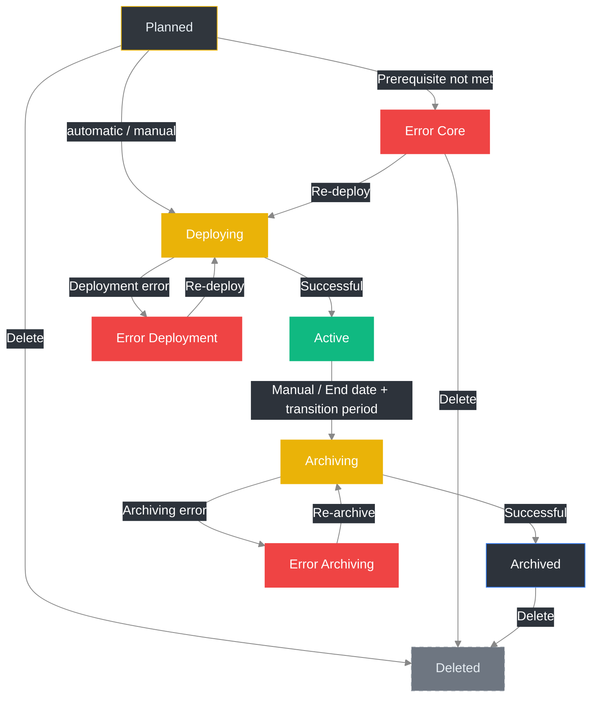

import { Example } from '@site/src/components/Example.mdx'
import { FeatureList } from '@site/src/components/FeatureList.mdx'
import { FieldReference } from '@site/src/components/FieldReference.mdx'
import { NavigationHint } from '@site/src/components/NavigationHint.mdx'
import { ObjectRelations } from '@site/src/components/ObjectRelations.mdx'
import { Permissions } from '@site/src/components/Permissions.mdx'
import { RelatedLinks } from '@site/src/components/RelatedLinks.mdx'

# Events

In **OpenVLE**, **events** form the organizational framework for an **environment**.  
They bundle environment content, user groups, and virtual machines, ensuring that learning or training scenarios are structured in terms of time, personnel, and technology.

{/* TODO: Add screenshot – Event overview */}

---

## Where can I find this section?

<NavigationHint
  path="Events"
  alternative="Linked via Users, Environments, or Virtual Machines"
/>

---

## Features at a Glance

<FeatureList
  items={[
    'Create, edit, and delete events',
    'Assign environments and user groups',
    'Start and stop events (deployment and decommissioning)',
    'Manage runtimes and automatic termination',
    'View active, planned, and completed events',
  ]}
/>

{/* TODO: Add screenshot – Event details */}

---

## Key Fields at a Glance

<FieldReference
  fields={[
    {
      name: 'Name',
      description:
        'Display name of the event. Shown in lists, dialogs, and connection names. After deployment, it becomes part of the connection title in Apache Guacamole.',
    },
    {
      name: 'Short Name',
      description:
        'Short identifier for the event (4-8 characters). Allowed characters are lowercase letters, numbers, underscores (_), and hyphens (-). Integrated into the names of created virtual machines during deployment.',
    },
    {
      name: 'Description',
      description:
        'Free text field to explain the purpose or content of the event. Displayed in overviews and detail views.',
    },
    {
      name: 'Environment',
      description:
        'Reference to the assigned environment. This environment defines the templates, applications, and network settings to be used for the event.',
    },
    {
      name: 'Start (Date)',
      description:
        'Start date of the event. From this point on, the assigned resources are available.',
    },
    {
      name: 'End (Date)',
      description:
        'End date of the event. If no end date is set, the event runs indefinitely. After the end date is reached, a configurable transition period begins (see **Administration -> Configuration**). After that, virtual machines, connections, and associated resources are automatically deleted.',
    },
    {
      name: 'Start (Time)',
      deprecated: true,
      description: 'No longer used.',
    },
    {
      name: 'End (Time)',
      deprecated: true,
      description: 'No longer used.',
    },
  ]}
/>

---

## Event Statuses

Each event in **OpenVLE** goes through several status phases during its lifecycle.  
The following overview describes the possible statuses and their meaning:

| Status                 | Description                                                                                                                                                                                                                                                                                                                                                                                                                       |
| ---------------------- | --------------------------------------------------------------------------------------------------------------------------------------------------------------------------------------------------------------------------------------------------------------------------------------------------------------------------------------------------------------------------------------------------------------------------------- |
| **Planned**            | Automatically set when creating an event. An event in the _Planned_ status is automatically deployed **X days before the start date**, so it is ready before the event begins. The number of days is configurable in the **System Settings** ([System -> Settings](/docs/usage/openvle/system/settings)) and is displayed in the detail view.   A manual transition from the _Planned_ status is **not possible**.        |
| **Deploying**          | The event is currently being provisioned ("deployment"). During this process, **no changes** can be made and **no participants can be added or removed**. The current progress can be viewed via the **tasks** assigned to the event.   After successful deployment, the status automatically changes to **Active**. If an error occurs, it changes to **Error (Deployment)**.                                            |
| **Active**             | The event is running and all associated VMs and connections are available. Changes (e.g., adding or removing participants) are possible in this status. The event remains active until the end date is reached (if set) or it is manually terminated.                                                                                                                                                                             |
| **Error (Core)**       | The deployment could not be started because a **fundamental prerequisite** was not met. A detailed error report is displayed in the event view.   From this status, a new provisioning attempt can be started — the event then returns to the **Deploying** status. Deletion is **possible**.                                                                                                                             |
| **Error (Deployment)** | The deployment has failed. A detailed error report is displayed in the event view.   From this status, a new provisioning attempt can be started — the event then returns to the **Deploying** status. Deletion is **not possible**.                                                                                                                                                                                      |
| **Error (Archiving)**  | Archiving has failed. A detailed error report is displayed in the event view.   From this status, a new archiving attempt can be started — the event then returns to the **Archiving** status. Deletion is **not possible**.                                                                                                                                                                                              |
| **Archiving**          | After the end date and the **transition period** configured in the **System Settings** have elapsed, or after a **manual termination**, the event is automatically set to this status.  During the archiving process, all associated **VMs** and **connections** are deleted.  After successful archiving, the status automatically changes to **Archived**. If an error occurs, it changes to **Error (Archiving)**. |
| **Archived**           | Archiving was completed successfully. All resources have been removed. Events in this status can **no longer be started** but can be **deleted**.                                                                                                                                                                                                                                                                                 |
| **Inactive**           | Internal state for deactivated or manually stopped events. This status rarely occurs and serves administrative purposes.                                                                                                                                                                                                                                                                                                          |
| **Stopped**            | Temporary state when an event has been manually stopped. The associated **VMs** are shut down and the **connections are deactivated** in this case. The event can be reactivated if needed.                                                                                                                                                                                                                                       |

**Important Notes**

- An event can **only** be deleted in the **Planned** or **Archived** statuses.
- During the **Deploying** or **Archiving** statuses, **no changes** are possible.
- The automatic transitions (e.g., from _Planned_ -> _Deploying_ -> _Active_ or _Active_ -> _Archiving_ -> _Archived_) are controlled by system processes and **cannot be triggered manually**.
- In the system settings under **System -> Settings**, both the **preparation time (pre-deployment)** and the **transition period after the end** can be configured.

> **Tip:**  
> If an error repeatedly occurs in the _Deploying_ or _Archiving_ status, check the associated **tasks**.  
> There you will find detailed error messages and logs for the cause.

---

### Status Transitions at a Glance

---

## Creating an Event {#create-event}

1. Open the **Events** section in the main menu.
2. Click **Add** to create a new event.
3. Assign a **name** and a **description**.
4. Select an existing **environment**.
5. Set the **start** and optionally the **end date** of the event.
6. Save the event.  
   The event will now be created with the status **"Planned"**.
7. Then add participants.

:::info Relationship between event and VM templates
When creating an event, the chosen environment is only stored as a reference. The direct relationship between the event and the VM templates is only created during **deployment**. If the environment is changed between creation and deployment, the event uses the **current** version of the environment during deployment.
:::

---

## Editing an Event {#edit-event}

1. Open the **Events** section in the main menu.
2. Search for the desired event in the list.
3. Click **Edit**, or open the event's context menu and select **Edit**.
4. The form displays all current event data.
5. Adjust the desired fields — for example, **Name**, **Description**, or **Environment**.
6. Save the changes.

:::warning
Only events in the **"Planned"** status can be edited.  
Changes to **Name**, **Description**, or the **assigned environment** are no longer possible in other statuses.
:::

---

## Importing Participants via CSV {#import-participants}

The **participant import** lets you add many **existing** users to an event in a single step by uploading a CSV file containing their email addresses.

<NavigationHint
  path="Events -> Detail view -> Participants -> Import"
  alternative="Via the 'Import' button in the event's participants area"
/>

:::warning Adds existing users — does not create any
The participant import looks up users **by their email address** (case-insensitive) and assigns them to the event with the **Participants (Students)** role. It **does not create new users**. Users who do not yet exist must first be created via the [user import](/docs/usage/openvle/access-control/users/#import-users).
:::

The import uses the same four-step wizard as the user import (Upload -> Map columns -> Preview & Import -> Result), but expects **only a single column**:

<FieldReference
  fields={[
    {
      name: 'email',
      description:
        'Required and the only column. Email address of an already existing user. Must contain an "@".',
    },
  ]}
/>

### Limits and result

- Each import processes at most **200 rows**; a maximum file size of **5 MB** also applies.
- After the import, the result view shows the outcome for each row. Common errors:
  - **Invalid email** – the address does not contain an "@".
  - **User not found** – no user exists for this email address (they must first be created via the user import).
  - **Unknown error** – adding the user failed for some other reason.

:::note
The import is only available while participants may be changed (e.g. in the **Planned** or **Active** statuses). During the **Deploying** or **Archiving** statuses, it is disabled.
:::

The import requires editing the event (`events_update`) as well as viewing users (`users_read`, see [Required Permissions](#required-permissions)).

---

## Deploying an Event

1. Open the **Events** section in the main menu.
2. Search for the desired event in the list.
3. Click **Deploy**, or open the event's context menu and select **Deploy**.
4. The form displays all current event data.
5. Confirm the deployment in the displayed dialog.
6. The event changes to the **"Deploying"** status; the **virtual machines** and **connections** are created.  
   The **creator** of the event will be notified of the progress via **email**.

:::warning
Only events in the **"Planned"** status can be deployed.
:::

:::note
During the **"Deploying"** status, **no changes** can be made to the event.  
After successful completion, the status changes to **"Active"**.
:::

---

## Terminating an Event (Archiving)

1. Open the **Events** section in the main menu.
2. Search for the desired event in the list.
3. Click **Stop**, or open the event's context menu and select **Stop**.
4. The form displays all current event data.
5. Confirm the termination in the displayed dialog.
6. The event changes to the **"Archiving"** status; the **virtual machines** and **connections** are deleted.  
   The **creator** of the event will be notified of the progress via **email**.

:::warning
Only events in the **"Active"** status can be terminated.
:::

:::note
During the **"Archiving"** status, **no changes** can be made to the event.  
After successful completion, the status changes to **"Archived"**.
:::

---

## Bulk Actions {#bulk-actions}

For **active** events, bulk actions are available to perform mass operations on all VMs or connections of an event simultaneously.

1. Open the **Events** section in the main menu.
2. Search for the desired event in the **"Active"** status in the list.
3. Open the detail view of the event.
4. Click the **Actions** button and select the desired bulk action.
5. Confirm the action in the displayed dialog.
6. The action is applied to all affected VMs or connections of the event simultaneously.

:::warning
Only events in the **"Active"** status support bulk actions.
:::

### VM Actions {#bulk-vm-actions}

The following actions can be applied to **all virtual machines** of an event simultaneously:

- **Start all VMs** — Starts all VMs of the event
- **Stop all VMs** — Stops all VMs immediately (hard stop)
- **Shut down all VMs** — Shuts down all VMs gracefully via the guest agent
- **Reboot all VMs** — Reboots all VMs
- **Reset all VMs** — Performs a hard reset on all VMs

### Connection Actions {#bulk-connection-actions}

The following actions can be applied to **all connections** of an event simultaneously:

- **Create all connections** — Recreates all connections of the event
- **Delete all connections** — Deletes all connections of the event

---

## Deleting an Event

1. Open the **Events** section in the main menu.
2. Search for the desired event in the list.
3. Click **Delete**, or open the event's context menu and select **Delete**.
4. Confirm the deletion in the displayed dialog.
5. The event will then be permanently removed.

:::warning
Only events in the **"Planned"** or **"Archived"** status can be deleted.
:::

---

## Example or Use Case

<Example title="Provision a new training event">
  An administrator wants to provision a training with an environment. They
  create the entry *"Linux Basics - Fall Course"* in the **Events** section, set
  the start and end dates, and select the **Beginners and Advanced**
  environment. After saving, they add all participants and start the
  **deployment**. This automatically creates and configures all associated
  virtual machines and connections.
</Example>

{/* TODO: Add screenshot – Example: Event with multiple environments */}

---

## Notes / Special Considerations

- An event contains exactly **one environment**, which can however reference multiple **VM templates**.
- Changes to the assigned environment (e.g., adding or removing VM templates) affect **planned** events, since the direct relationship between event and VM templates is only created during deployment. **Active** events are not affected.
- During **deployment**, virtual machines are created and configured for all participants based on the VM templates assigned to the environment.  
  Additionally, each participant receives individual connections based on the **connection templates** assigned to the respective VM templates.  
  Participants with the **Instructor** role also receive connections to **all** virtual machines of the event.
- The **Stop** button can be used to terminate **and** remove all VMs of the event.
- The **creator** of an event automatically receives **full access permissions** for **all created virtual machines and connections**.
- **Participants** automatically receive the **"Read & VM Control"** permission for **their own virtual machine**.
- Changes to a running event (e.g., adding or removing participants) take effect immediately.
- Events with active deployment can only be terminated by users with the permission (`events_actions_end`).
- Starting or stopping an event may take some time depending on the number of VMs.  
  The creator automatically receives an **email notification** once the deployment or stopping/archiving is completed or an error has occurred.
- The display updates regularly as long as the section is open.

---

## Relationships to Other Objects

<ObjectRelations
  showTasks={true}
  items={[
    {
      object: 'Environments',
      description: 'Each event is assigned exactly one environment.',
      behavior: 'No automations.',
    },
    {
      object: 'Participants (Users)',
      description: 'Any number of participants can be assigned to an event.',
      behavior: 'No automations.',
    },
    {
      object: 'VM Templates',
      description: 'Any number of VM templates can be assigned to an event.',
      behavior: 'No automations.',
    },
    {
      object: 'Emails',
      description: 'Any number of sent emails can be assigned to an event.',
      behavior: 'No automations.',
    },
    {
      object: 'Virtual Machines (VMs)',
      description: 'Any number of VMs can be assigned to an event.',
      behavior:
        'When the event is terminated, all associated VMs are automatically deleted.',
    },
    {
      object: 'Connections',
      description: 'Any number of connections can be assigned to an event.',
      behavior:
        'When the event is terminated, all associated connections are automatically deleted.',
    },
  ]}
/>

---

## Required Permissions

<Permissions
  data={[
    {
      action: 'View events',
      permission: 'events_read',
      scoped: true,
    },
    { action: 'Create events', permission: 'events_create' },
    {
      action: 'Edit events',
      permission: 'events_update',
      scoped: true,
    },
    {
      action: 'Delete events',
      permission: 'events_delete',
      scoped: true,
    },
    {
      action: 'Start events',
      permission: 'events_actions_start',
      scoped: true,
    },
    {
      action: 'Terminate events',
      permission: 'events_actions_end',
      scoped: true,
    },
    { action: 'View users', permission: 'users_read', scoped: true },
    { action: 'View environments', permission: 'courses_read', scoped: true },
  ]}
/>

---

## Related Topics

<RelatedLinks
  items={[
    { label: 'Environments', href: '../courses' },
    { label: 'Virtual Machines', href: '../vms' },
    { label: 'VM Templates', href: '../vm-templates' },
    { label: 'Connections', href: '../connections' },
  ]}
/>
