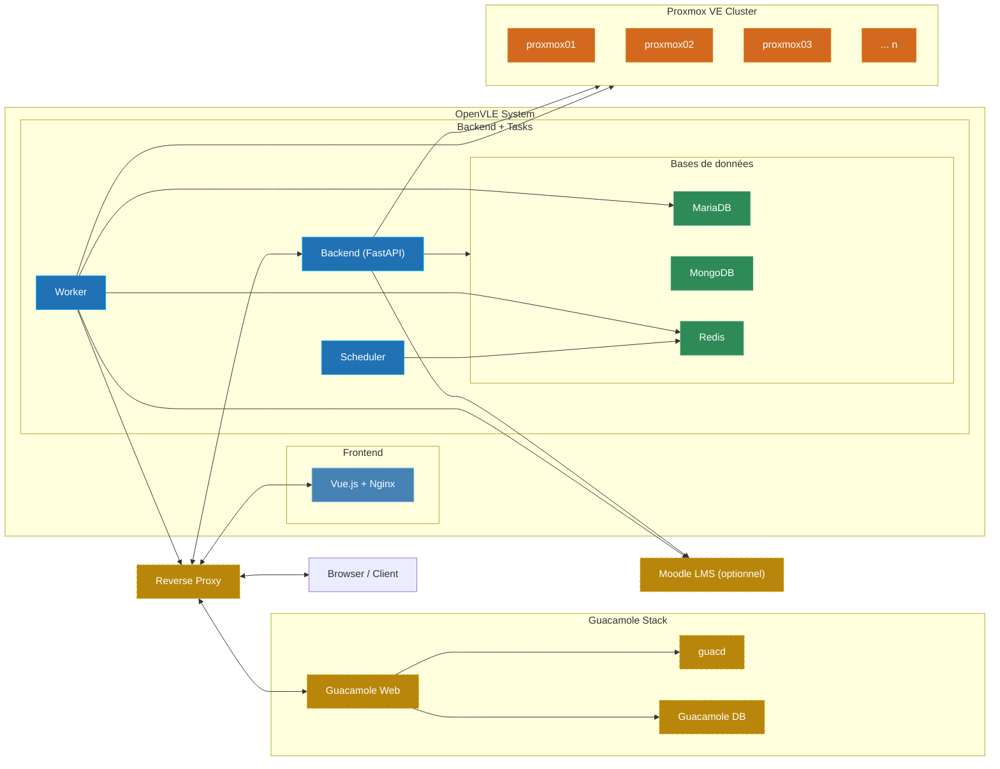

# Infrastructure {#infrastructure}

OpenVLE se compose de plusieurs conteneurs Docker exploités ensemble sous forme de stack Docker Compose. Des systèmes externes (Proxmox VE, en option Apache Guacamole et Moodle) sont également connectés. Cette section décrit l'architecture, les composants utilisés et leurs interactions.

## Diagramme d'architecture {#architecture-diagram}

**Légende :**

| Couleur           | Signification                                                |
| ----------------- | ------------------------------------------------------------ |
| Jaune (pointillé) | Composants externes (Reverse Proxy, Guacamole Stack, Moodle) |
| Bleu (clair)      | Frontend — Application Vue.js avec Nginx                     |
| Bleu (foncé)      | Backend / Tasks — FastAPI, Worker, Scheduler                 |
| Vert              | Bases de données — MariaDB, MongoDB, Redis                   |
| Orange            | Proxmox VE Cluster — Infrastructure hyperviseur (externe)    |

## Composants en un coup d'oeil {#components-overview}

### Stack Docker OpenVLE {#internal-components}

| Composant            | Type              | Fonction                                                                      |
| -------------------- | ----------------- | ----------------------------------------------------------------------------- |
| **Backend**          | Python/FastAPI    | API REST, logique métier, intégration Proxmox                                 |
| **Frontend**         | Vue.js/Nginx      | Interface web                                                                 |
| **Worker** (3 types) | RQ Worker         | Tâches asynchrones en arrière-plan (opérations VM, e-mail, Guacamole, Moodle) |
| **Scheduler**        | RQ Cron           | Tâches périodiques planifiées                                                 |
| **MariaDB**          | BDD relationnelle | Entités principales (utilisateurs, rôles, environnements, VMs, ...)           |
| **MongoDB**          | BDD documents     | Activités, événements système, journaux d'audit                               |
| **Redis**            | In-Memory         | File d'attente des tâches et cache                                            |

### Systèmes externes {#external-systems}

| Système              | Requis                | Fonction                                             |
| -------------------- | --------------------- | ---------------------------------------------------- |
| **Proxmox VE**       | Oui                   | Cluster hyperviseur pour la gestion des VMs          |
| **Reverse Proxy**    | Recommandé            | Terminaison SSL et routage                           |
| **Apache Guacamole** | Optionnel, recommandé | Accès bureau à distance aux VMs via le web           |
| **Moodle**           | Optionnel             | Intégration du système de gestion de l'apprentissage |
| **Serveur SMTP**     | Oui                   | Envoi d'e-mails                                      |
| **Serveur LDAP**     | Optionnel             | Authentification des utilisateurs                    |
| **Fournisseur OIDC** | Optionnel             | Single Sign-On                                       |

:::info Dépendances externes
**Proxmox VE**, **Apache Guacamole** et **Moodle** ne sont pas exploités dans le stack Docker Compose d'OpenVLE. Ils doivent être installés et configurés séparément. Consultez [Intégration Proxmox VE](../install/proxmoxve), [Intégration Apache Guacamole](../install/guacamole) et [Intégration Moodle](../install/moodle) pour la mise en place.
:::

## Pour aller plus loin {#topics}

1. [Composants utilisés](components) — Conteneurs Docker en détail : SERVICE_ROLE, ports, Health Checks, persistance
2. [Réseau & Docker](networking) — Réseau Docker, ports et chemins de communication
3. [Bases de données](databases) — MariaDB, MongoDB et Redis : répartition des tâches et stockage des données
4. [Système de tâches](task-system) — Worker, Scheduler et la file d'attente Redis pour les tâches en arrière-plan
5. [Authentification](authentication) — Connexion locale, LDAP et OIDC
6. [Système de permissions](permission-system) — Rôles, permissions et contrôle d'accès
7. [Proxmox VE](proxmoxve) — Gestion des VMs, gestion des noeuds et intégration cluster **(requis)**
8. [Apache Guacamole](guacamole) — Accès bureau à distance via Apache Guacamole _(optionnel, recommandé)_
9. [Moodle](moodle) — Intégration au système de gestion de l'apprentissage Moodle _(optionnel)_
