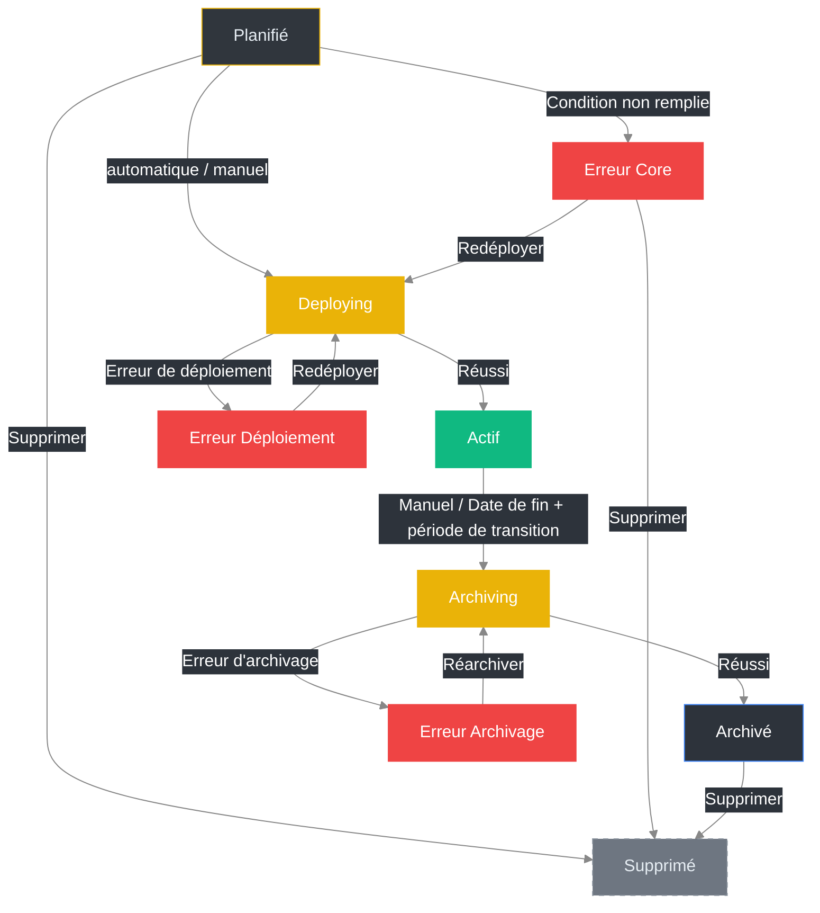

import { Example } from '@site/src/components/Example.mdx'
import { FeatureList } from '@site/src/components/FeatureList.mdx'
import { FieldReference } from '@site/src/components/FieldReference.mdx'
import { NavigationHint } from '@site/src/components/NavigationHint.mdx'
import { ObjectRelations } from '@site/src/components/ObjectRelations.mdx'
import { Permissions } from '@site/src/components/Permissions.mdx'
import { RelatedLinks } from '@site/src/components/RelatedLinks.mdx'

# Événements

Dans **OpenVLE**, les **événements** constituent le cadre organisationnel d'un **environnement**.  
Ils regroupent les contenus d'environnement, les groupes d'utilisateurs et les machines virtuelles, et garantissent que les scénarios d'apprentissage ou de formation se déroulent de manière structurée sur les plans temporel, personnel et technique.

{/* TODO: Ajouter une capture d'écran – Aperçu des événements */}

---

## Où trouver cette section ?

<NavigationHint
  path="Événements"
  alternative="Accessible via les liens Utilisateurs, Environnements ou Machines virtuelles"
/>

---

## Aperçu des fonctionnalités

<FeatureList
  items={[
    'Créer, modifier et supprimer des événements',
    "Attribuer des environnements et des groupes d'utilisateurs",
    'Démarrer et arrêter des événements (déploiement et décommissionnement)',
    "Gérer les durées d'exécution et l'arrêt automatique",
    'Consulter les événements actifs, planifiés et terminés',
  ]}
/>

{/* TODO: Ajouter une capture d'écran – Détails d'un événement */}

---

## Aperçu des champs importants

<FieldReference
  fields={[
    {
      name: 'Nom',
      description:
        "Nom d'affichage de l'événement. Affiché dans les listes, les boîtes de dialogue et les noms de connexion. Après le déploiement, il fait partie du titre de connexion dans Apache Guacamole.",
    },
    {
      name: 'Nom court',
      description:
        "Abréviation de l'événement (4 à 8 caractères). Sont autorisés les lettres minuscules, les chiffres, les tirets bas (_) et les tirets (-). Intégré dans les noms des machines virtuelles créées lors du déploiement.",
    },
    {
      name: 'Description',
      description:
        "Champ de texte libre pour expliquer l'objectif ou le contenu de l'événement. Affiché dans les aperçus et les vues détaillées.",
    },
    {
      name: 'Environnement',
      description:
        "Référence à l'environnement attribué. Cet environnement définit les modèles, applications et paramètres réseau à utiliser pour l'événement.",
    },
    {
      name: 'Début (date)',
      description:
        "Date de début de l'événement. À partir de ce moment, les ressources attribuées sont disponibles.",
    },
    {
      name: 'Fin (date)',
      description:
        "Date de fin de l'événement. Si aucune date de fin n'est définie, l'événement se poursuit indéfiniment. Après avoir atteint la date de fin, une période de transition configurable commence (voir **Administration → Configuration**). Ensuite, les machines virtuelles, connexions et ressources associées sont automatiquement supprimées.",
    },
    {
      name: 'Début (heure)',
      deprecated: true,
      description: "N'est plus utilisé.",
    },
    {
      name: 'Fin (heure)',
      deprecated: true,
      description: "N'est plus utilisé.",
    },
  ]}
/>

---

## Différents statuts d'un événement

Chaque événement dans **OpenVLE** passe par plusieurs phases de statut au cours de son cycle de vie.  
L'aperçu suivant décrit les statuts possibles et leur signification :

| Statut                   | Description                                                                                                                                                                                                                                                                                                                                                                                                                                      |
| ------------------------ | ------------------------------------------------------------------------------------------------------------------------------------------------------------------------------------------------------------------------------------------------------------------------------------------------------------------------------------------------------------------------------------------------------------------------------------------------ |
| **Planifié**             | Défini automatiquement lors de la création. Un événement au statut _Planifié_ est automatiquement déployé **X jours avant la date de début**, afin qu'il soit prêt avant le démarrage. Le nombre de jours est configurable dans les **paramètres système** ([Système → Paramètres](/docs/usage/openvle/system/settings)) et affiché dans la vue détaillée.   Une transition manuelle depuis le statut _Planifié_ n'est **pas possible**. |
| **Deploying**            | L'événement est en cours de déploiement. Pendant ce processus, **aucune modification** ne peut être apportée et **aucun participant ne peut être ajouté ou retiré**. La progression actuelle peut être consultée via les **tâches** assignées à l'événement.   Après un déploiement réussi, le statut passe automatiquement à **Actif**. En cas d'erreur, il passe à **Erreur (Déploiement)**.                                           |
| **Actif**                | L'événement est en cours et toutes les VM et connexions associées sont disponibles. Des modifications (par ex. ajout ou retrait de participants) sont possibles dans ce statut. L'événement reste actif jusqu'à ce que la date de fin soit atteinte (le cas échéant) ou qu'il soit arrêté manuellement.                                                                                                                                          |
| **Erreur (Core)**        | Le déploiement n'a pas pu être lancé car une **condition préalable fondamentale** n'était pas remplie. Un rapport d'erreur détaillé est affiché dans la vue de l'événement.   Depuis ce statut, une nouvelle tentative de déploiement peut être lancée. L'événement passe alors de nouveau au statut **Deploying**. La suppression est **possible**.                                                                                     |
| **Erreur (Déploiement)** | Le déploiement a échoué. Un rapport d'erreur détaillé est affiché dans la vue de l'événement.   Depuis ce statut, une nouvelle tentative de déploiement peut être lancée. L'événement passe alors de nouveau au statut **Deploying**. La suppression n'est **pas possible**.                                                                                                                                                             |
| **Erreur (Archivage)**   | L'archivage a échoué. Un rapport d'erreur détaillé est affiché dans la vue de l'événement.   Depuis ce statut, une nouvelle tentative d'archivage peut être lancée. L'événement passe alors de nouveau au statut **Archiving**. La suppression n'est **pas possible**.                                                                                                                                                                   |
| **Archiving**            | Après l'expiration de la date de fin et de la **période de transition** configurée dans les **paramètres système**, ou après un **arrêt manuel**, l'événement passe automatiquement dans ce statut.  Pendant le processus d'archivage, toutes les **VM** et **connexions** associées sont supprimées.  Après un archivage réussi, le statut passe automatiquement à **Archivé**. En cas d'erreur, il passe à **Erreur (Archivage)**. |
| **Archivé**              | L'archivage a été terminé avec succès. Toutes les ressources ont été supprimées. Les événements dans ce statut ne peuvent **plus être démarrés**, mais peuvent être **supprimés**.                                                                                                                                                                                                                                                               |
| **Inactif**              | État interne pour les événements désactivés ou arrêtés manuellement. Ce statut survient rarement et sert à des fins administratives.                                                                                                                                                                                                                                                                                                             |
| **Stopped**              | État temporaire lorsqu'un événement a été arrêté manuellement. Les **VM** associées sont dans ce cas éteintes et les **connexions désactivées**. L'événement peut être réactivé si nécessaire.                                                                                                                                                                                                                                                   |

**Remarques importantes**

- Un événement ne peut être **supprimé** que dans les statuts **Planifié** ou **Archivé**.
- Pendant les statuts **Deploying** ou **Archiving**, **aucune modification** n'est possible.
- Les transitions automatiques (par ex. de _Planifié_ → _Deploying_ → _Actif_ ou _Actif_ → _Archiving_ → _Archivé_) sont gérées par des processus système et ne peuvent **pas être déclenchées manuellement**.
- Dans les paramètres système sous **Système → Paramètres**, le **temps de préparation (pré-déploiement)** ainsi que la **période de transition après la fin** peuvent être configurés.

> **Conseil :**  
> Si une erreur survient de manière répétée dans le statut _Deploying_ ou _Archiving_, vérifiez les **tâches** associées.  
> Vous y trouverez des messages d'erreur détaillés et des journaux concernant la cause.

---

### Aperçu des transitions de statut

---

## Créer un événement {#create-event}

1. Ouvrez dans le menu principal la section **Événements**.
2. Cliquez sur **Ajouter** pour créer un nouvel événement.
3. Attribuez un **nom** et une **description**.
4. Sélectionnez un **environnement** existant.
5. Définissez la **date de début** et éventuellement la **date de fin** de l'événement.
6. Enregistrez l'événement.  
   L'événement est alors créé avec le statut **« Planifié »**.
7. Ajoutez ensuite des participants.

:::info Relation entre l'événement et les modèles de VM
Lors de la création d'un événement, l'environnement choisi n'est enregistré que comme référence. La relation directe entre l'événement et les modèles de VM n'est créée que lors du **déploiement**. Si l'environnement est modifié entre la création et le déploiement, l'événement utilisera la version **actuelle** de l'environnement lors du déploiement.
:::

---

## Modifier un événement {#edit-event}

1. Ouvrez dans le menu principal la section **Événements**.
2. Recherchez l'événement souhaité dans la liste.
3. Cliquez sur **Modifier**, ou ouvrez le menu contextuel de l'événement et sélectionnez **Modifier**.
4. Le formulaire affiche toutes les données actuelles de l'événement.
5. Ajustez les champs souhaités, par exemple **Nom**, **Description** ou **Environnement**.
6. Enregistrez les modifications.

:::warning
Seuls les événements au statut **« Planifié »** peuvent être modifiés.  
Les modifications du **Nom**, de la **Description** ou de l'**environnement attribué** ne sont plus possibles dans les autres statuts.
:::

---

## Importer des participants via CSV {#import-participants}

L'**import de participants** vous permet d'ajouter de nombreux utilisateurs **existants** à un événement en une seule étape, en téléversant un fichier CSV contenant leurs adresses e-mail.

<NavigationHint
  path="Événements → Vue détaillée → Participants → Importer"
  alternative="Via le bouton « Importer » dans la zone des participants de l'événement"
/>

:::warning Ajoute des utilisateurs existants — n'en crée aucun
L'import de participants recherche les utilisateurs **par leur adresse e-mail** (insensible à la casse) et les affecte à l'événement avec le rôle **Participants (Students)**. Il **ne crée pas de nouveaux utilisateurs**. Les utilisateurs qui n'existent pas encore doivent d'abord être créés via l'[import d'utilisateurs](/docs/usage/openvle/access-control/users/#import-users).
:::

L'import utilise le même assistant en quatre étapes que l'import d'utilisateurs (Téléverser → Associer les colonnes → Aperçu et import → Résultat), mais n'attend **qu'une seule colonne** :

<FieldReference
  fields={[
    {
      name: 'email',
      description:
        "Obligatoire et seule colonne. Adresse e-mail d'un utilisateur déjà existant. Doit contenir un « @ ».",
    },
  ]}
/>

### Limites et résultat

- Chaque import traite au maximum **200 lignes** ; une taille de fichier maximale de **5 Mo** s'applique également.
- Après l'import, la vue des résultats indique le résultat pour chaque ligne. Erreurs fréquentes :
  - **E-mail invalide** – l'adresse ne contient pas de « @ ».
  - **Utilisateur introuvable** – aucun utilisateur n'existe pour cette adresse e-mail (il doit d'abord être créé via l'import d'utilisateurs).
  - **Erreur inconnue** – l'ajout de l'utilisateur a échoué pour une autre raison.

:::note
L'import n'est disponible que tant que les participants peuvent être modifiés (par ex. dans les statuts **Planifié** ou **Actif**). Pendant les statuts **Deploying** ou **Archiving**, il est désactivé.
:::

L'import nécessite la modification de l'événement (`events_update`) ainsi que l'affichage des utilisateurs (`users_read`, voir [Permissions requises](#permissions-requises)).

---

## Déployer un événement

1. Ouvrez dans le menu principal la section **Événements**.
2. Recherchez l'événement souhaité dans la liste.
3. Cliquez sur **Déployer**, ou ouvrez le menu contextuel de l'événement et sélectionnez **Déployer**.
4. Le formulaire affiche toutes les données actuelles de l'événement.
5. Confirmez le déploiement dans la boîte de dialogue affichée.
6. L'événement passe au statut **« Deploying »** ; les **machines virtuelles** et les **connexions** sont créées.  
   Le **créateur** de l'événement est notifié par **e-mail** de la progression.

:::warning
Seuls les événements au statut **« Planifié »** peuvent être déployés.
:::

:::note
Pendant le statut **« Deploying »**, **aucune modification** de l'événement n'est possible.  
Après un achèvement réussi, le statut passe à **« Actif »**.
:::

---

## Terminer un événement (archivage)

1. Ouvrez dans le menu principal la section **Événements**.
2. Recherchez l'événement souhaité dans la liste.
3. Cliquez sur **Arrêter**, ou ouvrez le menu contextuel de l'événement et sélectionnez **Arrêter**.
4. Le formulaire affiche toutes les données actuelles de l'événement.
5. Confirmez l'arrêt dans la boîte de dialogue affichée.
6. L'événement passe au statut **« Archiving »** ; les **machines virtuelles** et les **connexions** sont supprimées.  
   Le **créateur** de l'événement est notifié par **e-mail** de la progression.

:::warning
Seuls les événements au statut **« Actif »** peuvent être terminés.
:::

:::note
Pendant le statut **« Archiving »**, **aucune modification** de l'événement n'est possible.  
Après un achèvement réussi, le statut passe à **« Archivé »**.
:::

---

## Actions en masse {#bulk-actions}

Pour les événements **actifs**, des actions en masse sont disponibles pour effectuer des opérations groupées sur toutes les VM ou connexions d'un événement simultanément.

1. Ouvrez dans le menu principal la section **Événements**.
2. Recherchez dans la liste l'événement souhaité au statut **« Actif »**.
3. Ouvrez la vue détaillée de l'événement.
4. Cliquez sur le bouton **Actions** et sélectionnez l'action en masse souhaitée.
5. Confirmez l'action dans la boîte de dialogue affichée.
6. L'action est appliquée simultanément à toutes les VM ou connexions concernées de l'événement.

:::warning
Seuls les événements au statut **« Actif »** prennent en charge les actions en masse.
:::

### Actions sur les VM {#bulk-vm-actions}

Les actions suivantes peuvent être appliquées simultanément à **toutes les machines virtuelles** d'un événement :

- **Démarrer toutes les VM** -- Démarre l'ensemble des VM de l'événement
- **Arrêter toutes les VM** -- Arrête immédiatement l'ensemble des VM (arrêt forcé)
- **Éteindre toutes les VM** -- Éteint proprement l'ensemble des VM via le Guest Agent
- **Redémarrer toutes les VM** -- Redémarre l'ensemble des VM
- **Réinitialiser toutes les VM** -- Effectue un redémarrage forcé de toutes les VM

### Actions sur les connexions {#bulk-connection-actions}

Les actions suivantes peuvent être appliquées simultanément à **toutes les connexions** d'un événement :

- **Créer toutes les connexions** -- Recrée toutes les connexions de l'événement
- **Supprimer toutes les connexions** -- Supprime l'ensemble des connexions de l'événement

---

## Supprimer un événement

1. Ouvrez dans le menu principal la section **Événements**.
2. Recherchez l'événement souhaité dans la liste.
3. Cliquez sur **Supprimer**, ou ouvrez le menu contextuel de l'événement et sélectionnez **Supprimer**.
4. Confirmez la suppression dans la boîte de dialogue affichée.
5. L'événement est alors définitivement supprimé.

:::warning
Seuls les événements au statut **« Planifié »** ou **« Archivé »** peuvent être supprimés.
:::

---

## Exemple ou cas d'utilisation

<Example title="Mettre à disposition un nouvel événement de formation">
  Une administratrice souhaite mettre à disposition une formation avec un
  environnement. Elle crée dans la section **Événements** l'entrée *« Linux
  Fondamentaux -- Cours d'automne »*, définit les dates de début et de fin et
  sélectionne l'environnement **Débutants et avancés**. Après l'enregistrement,
  elle ajoute tous les participants et lance le **déploiement**. Toutes les
  machines virtuelles et connexions associées sont alors automatiquement créées
  et configurées.
</Example>

{/* TODO: Ajouter une capture d'écran – Exemple : événement avec plusieurs environnements */}

---

## Remarques / Particularités

- Un événement contient exactement **un environnement**, mais celui-ci peut référencer plusieurs **modèles de VM**.
- Les modifications apportées à l'environnement attribué (par ex. ajout ou retrait de modèles de VM) affectent les événements **planifiés**, car la relation directe entre l'événement et les modèles de VM n'est créée que lors du déploiement. Les événements **actifs** ne sont pas affectés.
- Lors du **déploiement**, des machines virtuelles sont créées et configurées pour chaque participant sur la base des modèles de VM attribués à l'environnement.  
  De plus, chaque participant reçoit des connexions individuelles basées sur les **modèles de connexion** attribués aux modèles de VM respectifs.  
  Les participants ayant le rôle **Enseignant** reçoivent en outre des connexions vers **toutes** les machines virtuelles de l'événement.
- Via le bouton **Arrêter**, toutes les VM de l'événement peuvent être arrêtées **et** supprimées.
- Le **créateur** d'un événement reçoit automatiquement des **permissions d'accès complet** sur **toutes les machines virtuelles et connexions créées**.
- Les **participants** reçoivent automatiquement la permission **« Lecture et contrôle de VM »** sur **leur propre machine virtuelle**.
- Les modifications apportées à un événement en cours (par ex. ajout ou retrait de participants) prennent effet immédiatement.
- Les événements avec un déploiement actif ne peuvent être terminés que par des utilisateurs disposant de la permission (`events_actions_end`).
- Le démarrage ou l'arrêt d'un événement peut prendre un certain temps en fonction du nombre de VM.  
  Le créateur reçoit automatiquement une **notification par e-mail** dès que le déploiement ou l'arrêt/archivage est terminé ou qu'une erreur est survenue.
- L'affichage se rafraîchit régulièrement tant que la section est ouverte.

---

## Relations avec d'autres objets

<ObjectRelations
  showTasks={true}
  items={[
    {
      object: 'Environnements',
      description:
        'Exactement un environnement est attribué à chaque événement.',
      behavior: 'Aucune automatisation.',
    },
    {
      object: 'Participants (Utilisateurs)',
      description:
        'Un nombre illimité de participants peut être assigné à un événement.',
      behavior: 'Aucune automatisation.',
    },
    {
      object: 'Modèles de VM',
      description:
        'Un nombre illimité de modèles de VM peut être associé à un événement.',
      behavior: 'Aucune automatisation.',
    },
    {
      object: 'E-mails',
      description:
        "Un nombre illimité d'e-mails envoyés peut être attribué à un événement.",
      behavior: 'Aucune automatisation.',
    },
    {
      object: 'Machines virtuelles (VM)',
      description:
        'Un nombre illimité de VM peut être attribué à un événement.',
      behavior:
        "Lors de la terminaison de l'événement, toutes les VM associées sont automatiquement supprimées.",
    },
    {
      object: 'Connexions',
      description:
        'Un nombre illimité de connexions peut être attribué à un événement.',
      behavior:
        "Lors de la terminaison de l'événement, toutes les connexions associées sont automatiquement supprimées.",
    },
  ]}
/>

---

## Permissions requises

<Permissions
  data={[
    {
      action: 'Afficher les événements',
      permission: 'events_read',
      scoped: true,
    },
    { action: 'Créer des événements', permission: 'events_create' },
    {
      action: 'Modifier des événements',
      permission: 'events_update',
      scoped: true,
    },
    {
      action: 'Supprimer des événements',
      permission: 'events_delete',
      scoped: true,
    },
    {
      action: 'Démarrer des événements',
      permission: 'events_actions_start',
      scoped: true,
    },
    {
      action: 'Terminer des événements',
      permission: 'events_actions_end',
      scoped: true,
    },
    {
      action: 'Afficher les utilisateurs',
      permission: 'users_read',
      scoped: true,
    },
    {
      action: 'Afficher les environnements',
      permission: 'courses_read',
      scoped: true,
    },
  ]}
/>

---

## Sujets associés

<RelatedLinks
  items={[
    { label: 'Environnements', href: '../courses' },
    { label: 'Machines virtuelles', href: '../vms' },
    { label: 'Modèles de VM', href: '../vm-templates' },
    { label: 'Connexions', href: '../connections' },
  ]}
/>
